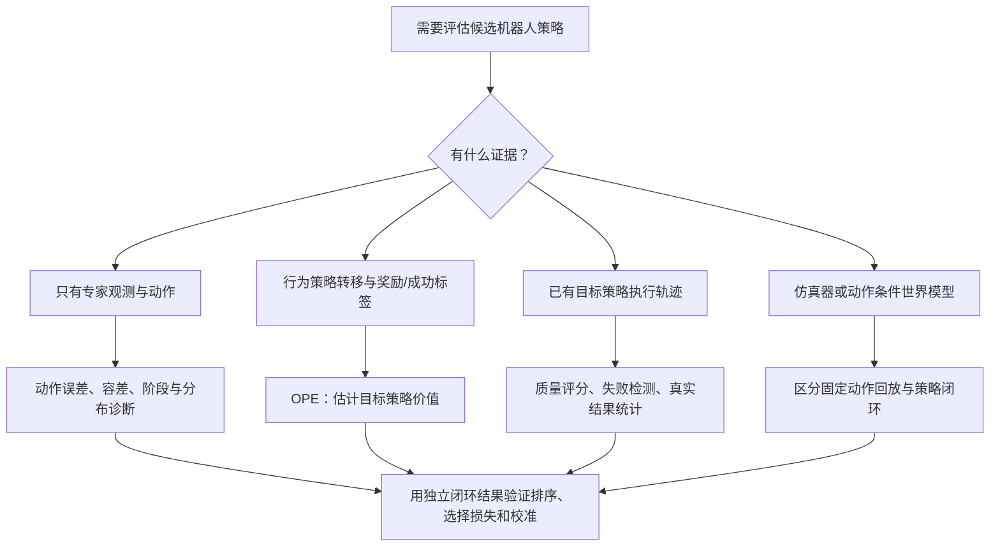

# 机器人操作策略离线评估：指标详解与近期研究的系统性综述

**检索截止：2026-10-20。** 基于 [2026 年 9 月原报告](offline-metric-threshold-accuracy-plan-2026-09.md)更新；研究范围与纳入标准见[已确认协议](robot-offline-evaluation-systematic-review-protocol-2026-10.md)。本文为 **AI 辅助、检索覆盖受限的系统性综述与技术解释**，未做元分析，不声称已经完成穷尽数据库检索或独立人工双人筛选。原报告中的机器人实验没有在本轮重跑。

## 摘要

机器人策略离线评估需要先确定评估目标：动作是否接近演示、已执行轨迹是否出现异常、未执行策略的预期回报有多高，是不同问题。本报告按预先确认的协议检索公开研究，核对原始论文、版本与技术报告，分层整理固定日志指标、离策略价值估计和无真机交互的模型评估。近期证据包括 2026 年 10 月的 RoboFQE、ProWorld、HF-WM，以及 CI-MSE、VLA-FAIL 的修订版。它们拓展了评估能力，也揭示数据覆盖、模型反馈、统计单位和分布变化的限制。原报告中 Dyna-2 阈值准确率的聚合定义需要更正；均方根/平均绝对误差比值也不能单独证明绝对尾部风险增加。对本项目，建议保留误差与简单基线，增加物理单位的联合容差、分阶段/执行窗口统计和 episode 级不确定度；用独立真机结果检验排序与选择效果后，再决定是否引入学习型评估器。文献异质性与检索限制不支持汇总一个通用相关系数。

**关键词：** 机器人操作；离线评估；视觉语言动作模型；动作分块；离策略评估；策略选择；世界模型。

**阅读导航：** 研究更新看 §4；逐项公式和适用条件看 §5–7；对旧报告的修正看 §8；项目推荐组合看 §10。VLA 指视觉语言动作模型（vision-language-action model），OPE 指离策略评估（off-policy evaluation）；“offline”在本文必须结合 §3 的数据来源分类理解。

## 1. 更新后最值得关注的结论

1. **不要用一个“离线准确率”同时代表动作精度和任务成功。** 原报告主要讨论固定观测下的动作匹配；新文献还覆盖回报估计、运行中失败监测和世界模型评估。它们的输入和验证目标不同。[CI-MSE](https://arxiv.org/html/2606.29898v2)、[RoboFQE](https://arxiv.org/html/2610.18699v1)、[VLA-FAIL](https://arxiv.org/html/2606.21386v2)。
2. **阈值指标必须写出聚合公式。** Dyna-2 当前页面定义的是一个时间步中**全部动作维度**同时在容差内的比例。原报告将其写成逐维度平均，二者不能直接对比。页面没有明确给出归一化细节。[Dyna-2，§3](https://www.dyna.co/dyna-2)。
3. **近期进展不仅是把 MSE 换成另一种误差。** CI-MSE 改变评测的时间片段与动作对齐；RoboFQE 从日志中学习目标策略价值；ProWorld 给闭环生成补充多视角与本体状态反馈。适用前提比“谁的相关系数最高”更值得先看。[CI-MSE](https://arxiv.org/html/2606.29898v2)、[RoboFQE](https://arxiv.org/html/2610.18699v1)、[ProWorld](https://arxiv.org/html/2610.15294v1)。
4. **相关性、排序、绝对预测误差和模型选择损失应分开报告。** 即使分数能排对名次，也不一定能说“实机成功率是 80%”。DOPE 已区分这些用途；本报告第 7 节给出可复现的定义。[DOPE](https://arxiv.org/pdf/2103.16596)。
5. **项目下一步优先改善口径和验证集。** 下文的落地方案是本报告的工程建议，不是已完成的新实验：统一动作语义与归一化、保留执行栈、报告误差分布及联合容差、按 episode 估计差异区间，再用配对实机结果验证指标。

## 2. 方法、范围和证据边界

### 2.1 问题与纳入范围

主问题是：**对机器人操作策略，现有离线指标预测闭环任务表现的有效性有何证据？**

主检索窗口为 2023-01-01 至 2026-10-20，更新重点为 2026-09-04 之后的新论文及已有论文修订版。基础方法不设最早年份。纳入指标定义、方法、基准和验证研究；预印本、正式论文和机构技术报告分别标识。纯训练工作只有在提供必要指标定义或执行机制时，才进入“背景/方法解释层”，不计作预测有效性的实证支持。

自动驾驶或纯导航不用于证明操作策略指标有效；一般统计方法只支持公式和分析方法。源文献“没有报告”与本轮“没有核实”分别记录。

### 2.2 实际检索与协议偏离

执行了英文主题检索、中文补充检索、原报告题名/标识符核查、以及重点论文参考文献追溯。精确查询、返回页面与错误信息保存在[证据目录](offline-evaluation-review-2026-10-evidence/)和[查询日志](offline-evaluation-review-2026-10-evidence/search-log.csv)。

预设的 arXiv API、arXiv 原生搜索页面和 OpenAlex API/页面均未能通过本环境取得可分页结果；本地网络请求也被环境拒绝。实际可用路径是网页搜索与原始论文页面访问，不能将其改写成“已完整搜索两个数据库”。OpenReview 部分 PDF 遇到验证页面，必要时使用作者公开页面或可访问的 arXiv 正文。PDF 截图工具未能工作，表格主要依据正文 HTML/PDF 文本核查；存在格式歧义的数字不作精确比较。

**因此，本文完成的是协议范围内、可追踪的证据综合，数据库覆盖目标未完全达到。** 对“最新”的表述只表示截止日内本轮找到并核实的工作，不能解释为没有遗漏同日或尚未被索引的研究。前向引用追踪也仅覆盖工具可见结果。

筛选和提取由一个主助手与两个分工检索助手完成；人类已确认问题和协议，**未有独立人类逐篇筛选/核验记录**。分工助手不等于两个独立人类审稿人。为避免补写不存在的过程，本轮未把提取前的口径检查称为完成了预定的独立 10 条筛选试验；这是协议执行偏离。

### 2.3 记录、评价与综合

检索网页命中、研究家族和作为方法背景的文献分别计数。版本更新、同一论文的项目页与会议版不作为独立研究；原始返回保留，登记范围内的去重与资格判断另存。[检索计数](offline-evaluation-review-2026-10-evidence/retrieval_counts.json)和[研究登记表](offline-evaluation-review-2026-10-evidence/study-register.csv)提供可复核过程，不能用搜索页面估算的“约多少条”作 PRISMA 数字。

实际执行 **61 条网页查询**，保存 377 次搜索页面命中、356 个不同搜索 URL。由保存页面识别出的 82 个 arXiv 家族，加 9 个非 arXiv 原始方法/技术报告候选，构成 **91 个登记家族**：40 个进入主线或方法层、14 个背景、37 个排除。排除理由为范围不符 E1（22）和训练方法而非相关评价 E2（15）；依据和来源层级逐行保存。**40 个纳入项不等于 40 项真机验证。**

这里不提供伪完整的数据库 PRISMA 漏斗：网页和研究的计数单位不同，未登记的非 arXiv 网页线索仍在返回表中，不能声称全部完成全文筛选。流程图与范围说明见[附件说明](offline-evaluation-review-2026-10-evidence/README.md)，计数可用附件脚本重建。

逐研究记录对象/任务覆盖、参照结果、统计单位、比较与报告限制，并把未独立审计的数据泄漏等项目保留为未知，见[40 项定性偏倚检查](offline-evaluation-review-2026-10-evidence/risk-of-bias.csv)。该检查表是本项目适配的工程方法，不宣称为经过验证的临床偏倚量表。作者自测、预印本或未开源不是自动排除条件；相应限制进入证据判断。

不做元分析：动作误差、成功率、Elo、视频质量标签、Pearson、Spearman 和失败检测曲线不是同一结局；多项结果还共享策略、数据集或任务，且缺少可比较的方差信息。本文按评估问题进行结构化综合，不平均这些分数，也不以“正向论文数量多”判定方法普遍有效。报告结构参考 [PRISMA 2020](https://www.prisma-statement.org/prisma-2020-statement)，不将结构映射当作完整合规认证。

## 3. 首先分清：评估数据是谁产生的？

| 类型 | 输入与操作 | 可以直接回答 | 不能直接回答 |
|---|---|---|---|
| 固定日志上的动作匹配 | 对录制观测输入目标策略，将预测与演示动作比较 | 在这批观测上的动作差异 | 新策略执行后会看到什么、能否恢复 |
| 已有 rollout 的轨迹判分/失败监测 | 对已执行的视频、动作、本体状态计算分数 | 这次执行是否平滑、是否失败、质量如何 | 从未执行策略的成功率，除非另外验证了预测机制 |
| 离策略评估（OPE） | 用行为策略日志、转移与奖励估计目标策略价值 | 满足假设时的预期回报 | 日志没有覆盖的行为在真实世界的确定后果 |
| 仿真或世界模型闭环评估 | 目标策略读取模型生成的下一观测并继续输出动作 | 目标策略在该模型中的表现 | 未校准条件下的真实成功率 |
| 固定动作序列的模型回放 | 给模型输入预录动作，观察生成结果 | 对该动作序列的模型预测 | 策略面对生成误差后的反馈反应 |
| 少量真机校准/主动选择 | 离线分数加有限真实试验 | 在给定试验预算下改进选择 | “完全无需在线交互” |

这是本报告依据方法输入作的分类；尤其要区别**“数据离线存着”**与**“完全没有执行过目标策略”**。[离策略分类评估](https://arxiv.org/abs/1906.01624)、[Sentinel](https://arxiv.org/html/2410.04640v1)、[Active Offline Policy Selection](https://arxiv.org/abs/2106.10251)分别说明其中不同场景。



### 3.1 为什么低离线误差不能自动推出高成功率？

令专家日志的状态分布为 \(d_D\)，策略真实执行时诱导的分布为 \(d_\pi\)。动作匹配通常测

\[
L_D(\pi)=\mathbb E_{o\sim d_D}\big[\ell(\pi(o),a^{\rm demo})\big],
\]

而任务表现取决于策略闭环轨迹：

\[
J(\pi)=\mathbb E_{\tau\sim\pi}\left[\sum_{t=0}^{T-1}\gamma^t r_t\right].
\]

两个期望的分布和目标都不同。小偏差可能使物体姿态改变，下一帧就偏离专家轨迹；反过来，偏离唯一示范的动作也可能是另一条正确路径。顺序决策中策略动作改变未来观测这一问题，是模仿学习分布偏移的基础。[Ross、Gordon 与 Bagnell，2011](https://proceedings.mlr.press/v15/ross11a.html)。

**本文推导的简单反例：** 同一场景专家可以绕障碍左行或右行，合法动作分别为 −1 和 +1。均值动作 0 的平均平方误差小于随机选择其中一侧，但 0 可能正对障碍。这说明“模仿一个参考动作的平均误差”与“合法闭环行为”不是同一目标；它不是某篇论文的实测结果。

## 4. 截止 2026-10-20 的研究更新

### 4.1 原报告之后的新工作与修订

表中数值均为作者报告，并未在本地复现。相关性的统计对象与参照结局一并列出，不能跨行作为排行榜。

| 工作与日期 | 方法与数据需求 | 已核实的证据 | 适用性限制 |
|---|---|---|---|
| **RoboFQE**，2026-10-13，预印本 | 预训练视觉表征 + 拟合 Q 评估；需要转移数据及终止成功标签，可由学习模型提供标签 | SO-101 三个叠块任务、三种目标策略；原文 Table 3 报 Pearson \(r=0.90\)、绝对相对误差 ARE 7.5%；另有 LIBERO/CALVIN 实验 | 三个实机任务物体/场景相近；缺少失败覆盖、越出日志支持集及不充分历史会损害估计。表 3 与附录对误差条说明存在差异，本文不将其 ± 数值解释为确定的置信区间。[正文及附录 A.2/A.4](https://arxiv.org/html/2610.18699v1) |
| **ProWorld**，2026-10-11，预印本 | 多视角世界模型同时反馈本体信息，服务于策略闭环评估 | 本地 3 策略×4 任务、200 条真实轨迹；作者摘要报 \(r=0.95,\rho=0.94\)；还使用 RoboChallenge 参照 | 轨迹数不等于独立策略数；评估的是模型环境中的闭环，且外部参照与本地试验来源不同。[论文](https://arxiv.org/abs/2610.15294) |
| **HF-WM**，2026-10-09，预印本；论文题名 *Beyond Successful Robot Demonstrations…* | 结合人类交互与失败动态训练世界模型 | 6 种策略、90 组匹配场景；附录 C.1 报六个策略聚合点的 \(r=0.9826\)、成功率 MAE 2.41 个百分点 | §4.4 输入初始观测与对应动作序列，不能据此认定策略逐步读取生成观测。极高相关性基于 6 个聚合点，外推有限。[论文](https://arxiv.org/abs/2610.13522) |
| **CI-MSE v2**，2026-10-13；v1 为 2026-06-29 | 关键区间选择、执行对齐、局部时间对齐；增补动作幅度归一化基线与选择后悔值 | 27 个仿真策略的 Spearman 为 −0.87，raw MSE 为 −0.61；另有四类实机任务的 Elo 对照 | 27 个策略的 headline 数字来自仿真。Unplug/环境变化中出现 \(+0.40\) 的反向相关；不保证域外成立。[§4–5](https://arxiv.org/html/2606.29898v2) |
| **VLA-FAIL v2**，2026-10-09；v1 为 2026-06-19 | 重叠动作块一致性与潜在空间偏离，进行运行中失败监测 | 两类 VLA、六个真实任务及 LIBERO-Plus；报告精确率—召回率和精确率—检测时刻关系 | 验证依赖已执行 rollout。多次 seed 重放同批轨迹不是独立机器人试验。[§3–4、附录 G.2](https://arxiv.org/html/2606.21386v2) |
| **RoboRecover**，2026-09-24，预印本 | 在预设执行偏离状态中测试恢复 | 两个平台共 2,000 个仿真场景，测恢复成功率和分组宏平均 | 不是固定日志代理指标；场景经过可恢复性筛选，没有直接真机排序验证。[原文](https://arxiv.org/html/2609.28952v1) |

### 4.2 应补入知识框架的较早工作

| 工作 | 它增加的评估视角 | 证据应该怎样使用 |
|---|---|---|
| **SIMPLER**，2024 | 用经过对齐的仿真检验真实策略；提出/使用 Pearson 与 MMRV 衡量评估器 | 附录的负 MSE 与实机表现有正相关也有负相关。不能从单一任务概括所有动作误差；其中 Google robot 的 MSE 使用训练轨迹，数据划分也需注意。[原文](https://arxiv.org/html/2405.05941) |
| **π2vec**，ICLR 2024 | 用后继特征表示策略，再学习性能预测器 | 有真实插齿和堆叠验证；主实验依赖历史策略已测回报。新策略无需执行，不等于整个系统无需实测监督。[原文](https://proceedings.iclr.cc/paper_files/paper/2024/file/9b01333262789ea3a65a5fab4c22feae-Paper-Conference.pdf) |
| **AutoEval 真机系统**，2025 | 自动运行、判成功和重置机器人 | 提供真实评价参照及动作 MSE 的局限证据；仍执行目标策略，不能算 rollout-free OPE。[原文](https://arxiv.org/html/2503.24278v2) |
| **Sentinel**，2024，CoRL | 统计动作一致性与视觉语言模型任务进展互补 | 平滑、稳定地做错事需要进展检测；动作波动可由一致性捕获。是运行监测，不是纯示范上的模型选择。[原文](https://arxiv.org/html/2410.04640v1) |
| **WorldGym**，2025 | 动作条件视频世界模型作为策略评估环境 | 将“比较动作”推进到“生成后果”；视频预测误差和成功判分误差需分别验证。[原文](https://arxiv.org/abs/2506.00613) |
| **WorldEval**，2025 | 用策略条件视频生成和成功判定估计表现 | 有双臂真机参照；与其迁移到 RoboTwin 的仿真基线比较，不等于直接比较 SIMPLER 官方配置。FID 在复杂清桌任务失效。[原文](https://arxiv.org/html/2505.19017v1) |
| **Scalable Policy Evaluation with Video World Models**，2025 | 视频闭环加视觉语言模型判分 | 仿真及少量真机任务；Table I 的相关性参照是 RoboMimic，不能误写真机。生成误差与判分误差均需考虑。[原文](https://arxiv.org/html/2511.11520v3) |
| **Veo world simulator**，2025 | 更大规模、多视角的生成式机器人评估 | 作者使用超过 1,600 个真实评估 episode 作对照；不能将特定系统结果外推到任意世界模型。[原文](https://arxiv.org/abs/2512.10675) |
| **PolaRiS**，2025 | 场景重建、物理仿真和分步进度评价 | 评价前对策略做真实/仿真混合微调；证据对应适配后的策略，不能当作冻结原策略的直接验证。[原文](https://arxiv.org/html/2512.16881v2) |
| **dWorldEval**，2026 | 离散扩散世界模型支撑可扩展评估 | 仍属于生成环境中的评估，其算力与模型训练数据不能从“无需本轮真机”中省略。[原文](https://arxiv.org/abs/2604.22152) |
| **SC3-Eval**，2026 | 以逆动力学一致性限制不可靠的生成 rollout | 七个同家族 checkpoint，相关点还区分成功标准。论文使用的 Pearson 测关联，不能因作者称其 calibration 就解释为绝对校准。[原文](https://arxiv.org/html/2606.18610v3) |
| **Eval-Actions 数据集及其 AutoEval 质量模型**，2026 | 对执行质量进行专家等级、排序与解释层面的评价 | AutoEval-S 的 SRCC 0.81/0.84 对应质量标签；输入是已取得的执行素材。它与上一行 2025 年真机 AutoEval 是不同研究。[原文](https://arxiv.org/html/2601.18723v2) |
| **PRM-as-a-Judge**，2026 | 过程奖励模型为轨迹提供密集评价 | 要区分过程标签、终止成功和模型偏好；不能把评判器分数直接当作新的物理实验。[原文](https://arxiv.org/abs/2603.21669) |
| **Discounted Liveness**，2026，RSS | 对稀疏成功、超时截断和恢复过程建模 | 两个仿真任务与真实布料演示；目标是轨迹进展/价值表达，不应将 timed-out 数据一律当作不可恢复失败。[原文](https://arxiv.org/html/2605.11479v1) |
| **ALOE**，2026，使用 v3 | 将动作块价值评估放入 VLA 后训练 | 当前版本报告四类实机操作任务；其整体流程包含在线采集与干预，训练收益不等于独立模型选择准确度。[原文](https://arxiv.org/html/2602.12691v3) |
| **FRAME**，2026，ICML workshop | 汇总任务、轨迹、安全与效率指标，实现过程诊断 | 可作为指标实现参考；库中有碰撞指标不表示仅凭动作日志能测出真实碰撞。原文明确安全项仍需相应传感器。[作者文档](https://ameyawagh.github.io/robometric-frame/) |
| **How VLAs Fail Differently**，2026，非归档 workshop 预印本 | 方向反转、jerk、速度违规等动作特征 | 不同模型的反转率 AUROC 约 0.79–0.93；任务与架构混杂、诊断子集较小，不能称为通用失败判据。[原文](https://arxiv.org/html/2605.28726v1) |
| **IRASim / WorldArena** | 在模型环境中运行策略，并检查排序 | 本轮提取的策略效度参照分别是 LIBERO 与 RoboTwin；“生成真实外观”不等于进行了物理机器人验证。[IRASim](https://openaccess.thecvf.com/content/ICCV2025/papers/Zhu_IRASim_A_Fine-Grained_World_Model_for_Robot_Manipulation_ICCV_2025_paper.pdf)、[WorldArena](https://arxiv.org/html/2602.08971v2) |
| **RobotArena∞ / RoboDojo** | 人类偏好、分步进度和标准化闭环基准 | 前者真机检查只有一个任务、三个策略；后者明确不构造仿真/真机配对任务。两类排行榜均不能自动当作大规模配对效度证据。[RobotArena∞](https://arxiv.org/html/2510.23571v3)、[RoboDojo](https://arxiv.org/html/2607.04434v3) |
| **WorldEcho / WorldSync**，2026-08 | 检查世界模型是否跟随给定动作 | 用轨迹误差和视觉完整性门控评价生成器；不是目标策略成功率。[原文](https://arxiv.org/html/2608.24885v1) |
| **ActFovea**，2026-07 | 运行中视觉—动作一致性监测及干预 | LIBERO 中的恢复增益包含修改观测/动作后的效果；风险分数裁剪至 [0,1] 也不意味着它是校准概率。[原文](https://arxiv.org/html/2607.29169v1) |
| **DreamDojo**，2026 | 通用世界模型的策略评价应用 | 真实水果装袋参照，按装入水果数/5 计部分完成率；作者承认绝对高估。不能把该分数当整任务二元成功率，闭环重决策细节也未充分说明。[原文 §4.7](https://arxiv.org/html/2602.06949) |
| **Runway GWM-Robotics 技术报告**，2026-02-27 | 闭环生成与人工进度评价 | 八个策略的排序验证；技术网页明确不保证绝对成功率校准。独立于 WorldGym，不重复并入其版本。[机构原文](https://runway.com/research/accelerating-robot-policy-evaluation) |

背景层还包括 OpenVLA 的动作离散化、OpenVLA-OFT 的连续 L1 训练、RTC 的部署时序，以及早期 FQE/DR/DOPE。这些说明“指标怎么定义/为什么要对齐”，不自动证明某个离线数字能替代真机结果。[OpenVLA](https://arxiv.org/html/2406.09246v3)、[OpenVLA-OFT](https://arxiv.org/html/2502.19645v2)、[RTC](https://arxiv.org/html/2506.07339v2)。

## 5. 固定数据上的指标：定义、读法和失效条件

### 5.1 先固定数学口径

以下是本报告用于解释和落地的统一记法，并非声称所有论文使用同一实现。

对 episode \(i\)、anchor \(t\)、预测 horizon \(h\)、动作维度 \(j\)，记预测为 \(\hat a_{ithj}\)，参考动作为 \(a_{ithj}\)，有效标记为 \(m_{ithj}\in\{0,1\}\)。定义

\[
e_{ithj}=\hat a_{ithj}-a_{ithj},\qquad
z_{ithj}=\frac{|e_{ithj}|}{s_j},\quad s_j>0.
\]

\(s_j\) 可以是训练集标准差、训练集分位数跨度或物理容差；三者的含义不同。`acc@0.1` 如果没有说明 \(s_j\)、动作空间和聚合轴，不能复现。正文公式默认只在有效槽位上统计。

还需选择“平均谁”：

- **micro 平均：** 所有有效时间/维度汇总，长轨迹和高频片段权重更高。
- **episode macro：** 每条轨迹先算一个数，再等权平均。
- **task macro：** 每个任务先聚合，再等权平均。
- **horizon macro：** 每个预测步先聚合，再等权平均；末端长 horizon 的有效样本较少，不能悄悄等同于全槽位 micro。

这是加权平均的直接区别。建议主表写明任务权重，保留每层分解；不要把三种平均下的差异误当成策略变化。

### 5.2 平均绝对误差 MAE、均方误差 MSE、均方根误差 RMSE

\[
\mathrm{MAE}=\frac{\sum m|e|}{\sum m},\qquad
\mathrm{MSE}=\frac{\sum me^2}{\sum m},\qquad
\mathrm{RMSE}=\sqrt{\mathrm{MSE}}.
\]

**测量什么：** 与参考动作在数值上的接近程度。MAE 与动作同单位；MSE 是单位的平方；RMSE 又回到原单位。平方误差会给较大偏差更大权重。MSE 和 RMSE 在同一集合上排序相同，但“先对各组开根再平均”不等于“总体 MSE 开根”。这些是上述定义的数学性质。

**优势：** 低成本、可分维度和 horizon、容易定位单位错误或实现退化。L1 也被用于连续动作训练，但训练目标有用不等于验证损失具有跨模型的任务效度。[OpenVLA-OFT](https://arxiv.org/html/2502.19645v2)。

**常见失效条件：**

- 静止或缓慢移动片段占大多数，保持当前位置即可得到不错的平均误差。
- 演示不唯一；点预测会偏好条件均值/中位数。
- 不同关节、位置、旋转、夹爪直接混合，数值大的单位主导总分。
- 全 horizon 误差很低，但真正执行的前几步表现较差。
- 使用专家观测反复重置策略状态，隐藏闭环误差传播。

前两项的闭环风险在分布偏移与多模态动作中尤其需要检查；不能把验证损失单独作为部署保证。[DAgger](https://proceedings.mlr.press/v15/ross11a.html)、[Diffusion Policy](https://arxiv.org/abs/2303.04137)、[SIMPLER 附录](https://arxiv.org/html/2405.05941)。

**项目建议：** 按臂、关节/末端、夹爪和执行窗口分别报告，加入 `hold_state`、合法零增量和训练均值等语义正确的基线。绝对关节目标可以保持当前关节；增量动作的“保持”应为零增量，不能直接照搬 state。

### 5.3 归一化误差与相对基线：便于比较，但需要固定标尺

\[
\mathrm{NMAE}=\frac{\sum mz}{\sum m},\qquad
\mathrm{NRMSE}=\sqrt{\frac{\sum mz^2}{\sum m}}.
\]

如果 \(s_j=\sigma_j^{\rm train}\)，`NMAE=0.1` 表示按训练动作标准差计的误差，**不是 0.1 rad，也不是成功率 90%**。近常量动作维度的 \(\sigma_j\) 很小，应声明 floor，并检查这种维度是否适合归一化。

本报告建议的相对基线量为

\[
\mathrm{Skill}_{L}=1-\frac{L_{\pi}}{L_{\rm baseline}},\qquad
\mathrm{Ratio}_{L}=\frac{L_{\rm baseline}}{L_\pi}.
\]

当分母为零或近零时应报告未定义/不稳定，而不是用任意 epsilon 得到夸张倍数。`Skill=0.3` 只表示该误差减少 30%，不能当作任务成功提升。

**跨 checkpoint 应使用同一评估标尺。** 每个模型用自己的训练集标准差或裁剪区间时，误差相同也可能分数不同。可以保留“模型原生归一化”用于训练诊断，但跨模型主表另用固定统计量和物理单位。OpenVLA 的 1%–99% 分位区间说明了动作编码的一种选择，不能据此反推其他工作的归一化。[OpenVLA §3.1](https://arxiv.org/html/2406.09246v3)。

### 5.4 acc@τ：必须区分逐维、整步和整段

逐维度容差通过率：

\[
A_{\rm dim}(\tau)=
\frac{\sum_{i,t,h,j}m_{ithj}\mathbf1[z_{ithj}\le\tau]}
{\sum_{i,t,h,j}m_{ithj}}.
\]

对指定关节集合 \(\mathcal J\)，令步级有效标记 \(m_{ith}=\prod_{j\in\mathcal J}m_{ithj}\)，即该集合内所有维度有效才计入；\(\tau_j\) 是与 \(e_j\) 同单位的物理容差。整时间步联合通过率：

\[
A_{\rm step}(\boldsymbol\tau)=
\frac{\sum_{i,t,h}m_{ith}\,
\mathbf1[\forall j\in\mathcal J:\ |e_{ithj}|\le\tau_j]}
{\sum_{i,t,h}m_{ith}}.
\]

整段指标还可要求执行窗口内**每个时间步**都通过，或通过比例达到 \(q\)。这两个定义也不同，不能统称为 chunk accuracy。

**本文的说明性例子：** 两个关节各有 50% 的时间达标。若它们在互补时间出错，联合通过率为 0%；若总是同时达标或同时出错，联合通过率为 50%。只有在独立等条件下才有乘积 \(0.5^2=25\%\)。逐维通过率无法决定联合通过率。

Dyna-2 当前原文采用整时间步全部维度通过的口径，见第 8 节更正。本文不复述其长段原文，公式按其含义重新表达。[Dyna-2](https://www.dyna.co/dyna-2)。

**阈值怎样选：**

- 工程容差优先用 mm、degree/rad 等物理单位，并与任务阶段相联系。
- 统计阈值可用于模型调试，但必须给出归一化标尺。
- 在验证集上定阈值，冻结后在测试集检验；不能看完真机排序再挑最有利的 \(\tau\)。
- 报完整容差曲线和少量预先指定读数，不只报最漂亮的一档。

**解释限制：** 全关节容差与末端容差都只是动作/几何约束。末端在目标容差内不保证物体已抓牢、接触力合适或任务完成；联合通过率低也可能受冗余自由度的多解影响。这是任务判定与动作判定的逻辑区别。

### 5.5 CDF、分位数和尾部：描述误差发生在哪里

经验累积分布函数（CDF）为

\[
\widehat F(x)=\frac1N\sum_{n=1}^N\mathbf1[z_n\le x].
\]

逐维 \(A_{\rm dim}(\tau)\) 是这一 CDF 的一个读数；联合通过率对应一组维度最大标准化误差的分布，不能从边际 CDF 恢复。\(q_p=\inf\{x:\widehat F(x)\ge p\}\) 是第 \(p\) 分位数。`p50` 描述中间水平，`p90/p95/p99` 描述高误差区间的边界。**p90 不是“最差 10% 的平均误差”。**

若要测最差部分的平均程度，可采用误差的上尾条件风险值：

\[
\mathrm{CVaR}_\alpha(z)=
\min_\eta\left\{\eta+\frac{1}{1-\alpha}\mathbb E[(z-\eta)_+]\right\}.
\]

该定义在存在阈值处概率质量时也明确；直接取 \(z\ge q_\alpha\) 的平均不一定与它相同。这里 CVaR 作为本报告建议的诊断扩展，不声称已被本轮机器人文献证明为最佳成功预测子。

**说明性例子：** A 的误差总是 0.1；B 有一半为 0、一半为 0.2。两者 MAE 都是 0.1；在容差 0.05 时 B 更高，在 0.15 时 A 更高。这展示了误差分布曲线交叉，不能仅靠均值判断。

**存储选择：**

- 保存逐样本误差可精确重算给定数据的任意阈值，但体积较大。
- 直方图只在已保存边界上精确恢复对应计数；落在桶内的任意阈值、分位数只能估计或给界。
- 对最大边界以外必须保留 overflow 数量；不能把超出上界的 p99 截成最后一个边界再称为“保守上界”。
- 若需数值精确的特定容差，把这些容差加入边界或独立计数，且统一 `<`/`≤`。

这些都是离散桶内信息不可逆丢失的直接后果。原报告“任意 τ 均可精确事后计算”的表述应收窄。

### 5.6 RMSE/MAE 比值：相对离散度，不能单独判定重尾

对非负绝对误差 \(z\)，只要 \(0<\mathbb E[z]<\infty\) 且二阶矩存在，

\[
R=\frac{\sqrt{\mathbb E[z^2]}}{\mathbb E[z]}
=\sqrt{1+\frac{\operatorname{Var}(z)}{\mathbb E[z]^2}}
=\sqrt{1+\mathrm{CV}(z)^2}.
\]

**这是本文直接推导。** \(R\) 衡量的是相对于均值的离散程度；它不是重尾分布的鉴别检验，也不保证 p99、最大误差或超限概率增加。

其中 CV 是变异系数，即标准差除以均值；MAE 为零时，全部误差为零，这一比值不定义，不能强行解释。

反例：A 的误差恒为 1，\(R_A=1\)；B 的误差 90% 为 0、10% 为 0.5，则均值 0.05、RMSE 约 0.158、\(R_B\approx3.162\)。B 的比值大幅上升，但最大误差反而从 1 降到 0.5。

先按训练动作标准差归一化，只消除了某种动作量纲差异，没有让各关节的**残差分布**变成同方差、同均值或同形状。再把不同阶段混合，仍会改变 \(R\)。因此旧报告中“滤波让 R 上升，所以绝对尾部加重”的解释需要用实际分位数、超限率和关键阶段错误补证。

10 月的 *Residual Modeling Closes…* 研究了机器人动作残差的异方差和重尾，并据此改进训练目标。这说明残差形状值得研究，但不能反过来把任意一个 RMSE/MAE 比值当成该分布结论的充分证据；此文在本综述仅作训练/分布背景。[原始摘要](https://arxiv.org/abs/2610.12231)。

### 5.7 关节误差与末端位姿误差

对关节角，应先识别该关节是有界还是周期变量；对于允许绕回的角度可采用

\[
e_\theta=\operatorname{atan2}(\sin(\hat\theta-\theta),\cos(\hat\theta-\theta)).
\]

有机械限位和绕线限制的关节不能无条件取最短角差。对于正运动学 \(p=f_p(q),R=f_R(q)\)，可以计算预测和参考末端目标：

\[
e_p=\|\hat p-p\|_2,\quad
e_R=\arccos\left(
\operatorname{clip}\left(\frac{\operatorname{tr}(R^\top\hat R)-1}{2},-1,1\right)
\right).
\]

单位四元数的等价旋转误差为

\[
e_R=2\arccos\left(\operatorname{clip}(|\langle\hat q,q\rangle|,0,1)\right).
\]

绝对值用于处理 \(q\) 与 \(-q\) 表示同一旋转。欧拉角逐维 MSE 可以描述特定坐标误差，但不应视为坐标不变的旋转测地角误差；旋转矩阵/6D 表征的 L2 也不是角度。这些公式是旋转几何定义，本文以此说明物理指标口径。

可定义几何联合通过率

\[
A_{\rm pose}(\epsilon_p,\epsilon_R)=
\Pr(e_p\le\epsilon_p,\ e_R\le\epsilon_R).
\]

双臂场景还可测相对变换 \(T_L^{-1}T_R\)，用于描述两末端的相对配合。**由预测关节目标算出的末端姿态是命令几何，不是机械臂实际到达姿态。** 想评估执行跟踪、接触或碰撞，还需要实测状态、标定和环境信息；FRAME 对安全指标的传感需求也作了明确区分。[FRAME](https://ameyawagh.github.io/robometric-frame/)。

### 5.8 夹爪状态与切换事件

连续夹爪宽度可以报 mm 误差；二值开合应单独报混淆矩阵、precision、recall、F1 或 balanced accuracy。以“闭合”为正类时：

\[
P=\frac{TP}{TP+FP},\quad R=\frac{TP}{TP+FN},\quad
F1=\frac{2PR}{P+R},\quad
\mathrm{BA}=\frac{\mathrm{TPR}+\mathrm{TNR}}2.
\]

零分母情况必须明示处理规则。一个始终保持张开的策略，在“多数时间张开”的数据上可以有高普通 accuracy，却完全不具备抓取能力；这是类别不平衡下的直接反例。

这里 TP、FP、FN 分别是真阳性、假阳性、假阴性计数，TPR 为正类召回率，TNR 为负类召回率。

本项目还应把“何时闭合”作为事件来测：预设匹配时间容差，将预测事件与参考事件一对一匹配，报告提前/滞后的有符号偏差、绝对时差、漏检与额外切换次数。避免一个事件匹配多个参考事件。该事件方案属于本报告建议，不冒称为统一行业标准。

### 5.9 horizon、执行窗口和关键阶段

**horizon 曲线：** 固定 \(h\) 计算 \(L_h\)，显示离当前时刻越远的预测是否退化。对于一次预测 \(H\) 步、实际只执行前 \(K\) 步的策略，建议将 `executed-prefix` 与 `full-chunk` 同时保存，以前者描述当次执行相关误差；不能默认后半段预测误差直接等于当前控制质量。

**部署对齐：** 延迟、动作裁剪、平滑、temporal ensembling、重规划与 RTC 会改变真正发送的命令。评估时同时保留 raw 与 deployed，按照一致时间戳重放执行状态；若每个 anchor 独立重置滤波器，得到的是另一套系统。[RTC](https://arxiv.org/html/2506.07339v2)。

**关键阶段：** 抓取闭合、插入、释放等时段可以设置独立指标，避免大量空闲帧稀释误差。但阶段标签须在看候选策略真机结果前确定。CI-MSE 将这一思想与执行/时间对齐结合；其 v2 在关键 anchor 内沿受限 DTW 路径平均动作平方 L2 误差，再对选中的 anchor 误差取中位数，不能用本报告普通 micro-MSE 公式冒充论文实现。[CI-MSE §3](https://arxiv.org/html/2606.29898v2)。

**项目建议：** 即使暂时没有足够真机结果，也可以添加阶段统计做诊断；只是不能提前宣称它已改善实机预测相关性。原报告将“关键区间统计”和“证明关键区间优于其他指标”捆绑为同一门槛，可以拆开处理。

### 5.10 轨迹距离、DTW 与时间偏差

若每个时间点代表相同物理时刻，可用末端平均位移误差（ADE）、终点误差（FDE）：

\[
\mathrm{ADE}=\frac1T\sum_t\|\hat p_t-p_t\|_2,\qquad
\mathrm{FDE}=\|\hat p_T-p_T\|_2.
\]

轨迹执行快慢不同而路径接近时，动态时间规整（DTW）允许在约束范围内匹配时间索引：

\[
\mathrm{DTW}(X,Y)=
\min_{\mathcal P}\sum_{(u,v)\in\mathcal P}d(x_u,y_v).
\]

必须说明局部代价、允许路径、时间带宽及是否按路径长度归一化。CI-MSE 使用局部 DTW 来处理一定时间变化；**过宽的对齐可能掩盖真实延迟或错过接触时机**，所以建议同时报告固定时标误差与对齐后误差。[CI-MSE](https://arxiv.org/html/2606.29898v2)。

把局部 action chunk 积分成末端路径时，还需要一致的坐标系和控制语义；速度/增量命令经过接触环境后形成的真实轨迹，不能仅通过自由空间积分假装已观测到。末端路径误差与实际执行轨迹误差应使用不同字段名。

### 5.11 多模态与生成式策略：训练损失、似然和样本分布

**负对数似然（NLL）：**

\[
\mathrm{NLL}=-\frac1N\sum_n\log p_\pi(a_n\mid o_n).
\]

它评价模型给参考动作的概率，而非参考动作与预测均值之间的距离。只在同一动作编码、参考分布与似然口径下比较；token 数、量化方法和 teacher forcing 条件不同，会改变数值含义。OpenVLA 的有序逐维标量分桶，与 VQ-VLA 的向量量化代码本不是同一种距离空间。[OpenVLA](https://arxiv.org/html/2406.09246v3)、[VQ-VLA](https://arxiv.org/html/2507.01016v1)。

**扩散噪声损失/flow matching 损失：** 衡量相应生成训练目标，不等于采样动作 MAE，更不是任务失败概率。需要固定噪声、时间采样与权重才可比较训练诊断。Diffusion Policy 的多模态动作建模是解释为什么需要区分这些目标的背景。[Diffusion Policy](https://arxiv.org/abs/2303.04137)。

**best-of-K：**

\[
L_{\min K}=\frac1N\sum_n\min_{k\le K}\ell(a_n^{(k)},a_n^{\rm demo}).
\]

增加 \(K\) 就可以机械性改善这个读数。若部署不会知道参考答案并选择最接近样本，它只是“样本集中是否包含一个接近参考的动作”的 oracle 指标。建议同时报随机单样本期望误差、固定 \(K\) 的分布评价及真实部署选择规则。

**Energy score（可探索的分布评分）：**

\[
\mathrm{ES}(P,y)=
\mathbb E\|X-y\|-\tfrac12\mathbb E\|X-X'\|,
\quad X,X'\overset{iid}{\sim}P.
\]

在相应矩条件下它是 proper scoring rule；第一项惩罚离观测太远，第二项避免简单地把预测分布压成一点。本报告将它列为生成式动作诊断的可选方法，**没有找到足够直接证据证明其在本项目上比动作误差更能预测成功**。它匹配的仍是演示条件分布，而非所有成功动作集合。[Gneiting 与 Raftery 原始论文](https://www.eecs.harvard.edu/cs286r/courses/fall10/papers/Gneiting07.pdf)。

**MMD/分布距离：**

\[
\mathrm{MMD}^2(P,Q)=
\mathbb E k(X,X')+\mathbb E k(Y,Y')-2\mathbb E k(X,Y).
\]

核、带宽、归一化和样本量都影响有限样本读数。它可以比较两组动作/轨迹分布，不能把不同观测下的动作混在一起后声称条件策略相同。机器人论文 Sentinel 用它比较同一未来时间段的重叠动作分布；这比无条件地比较整库动作直方图有更具体的控制含义。[MMD 原始方法](https://www.jmlr.org/papers/v13/gretton12a.html)、[Sentinel 附录 A](https://arxiv.org/html/2410.04640v1)。

### 5.12 动作块一致性、平滑性与运动约束

设相邻两次推理相距 \(K\) 步，分别预测 \(H\) 步。只有 \(K<H\) 才有重叠未来区间。一个通用、说明性的点一致性量是

\[
C_t=\frac1{(H-K)|\mathcal J|}
\sum_{h=0}^{H-K-1}\sum_{j\in\mathcal J}
\left|\hat a_{t,K+h,j}-\hat a_{t+K,h,j}\right|.
\]

这不是 VLA-FAIL 的完整公式：其 ACC 使用绝对末端位置重叠误差、分维 chunk range 归一化及时间平滑；Sentinel 则考虑多模态样本分布。两者都提醒我们，一次重规划“改变计划”可能是异常，也可能是在纠正物体移动。[VLA-FAIL §3.2](https://arxiv.org/html/2606.21386v2)、[Sentinel](https://arxiv.org/html/2410.04640v1)。

如果 \(a_t\) 是位置目标，离散速度、加速度、jerk 分别近似为一、二、三阶差分除以 \(\Delta t,\Delta t^2,\Delta t^3\)。若 \(a_t\) 原本就是速度，差分的物理含义相应改变。报告 jerk 时应说明单位、采样率、滤波器及计算对象是命令还是实测位置。

方向反转率、路径长度、关节/速度超限比例也可用于诊断；低 jerk 或低反转并不保证成功，停止动作就很平滑。动作监测研究提供的是特定任务上与失败的统计联系，不能把这些指标写成碰撞安全证书。[How VLAs Fail Differently](https://arxiv.org/html/2605.28726v1)、[FRAME](https://ameyawagh.github.io/robometric-frame/)。

## 6. 学习型评估器：需要哪些额外假设？

### 6.1 失败检测和成功概率

若评估器输出失败分数，常用 ROC 曲线下面积（AUROC）和精确率—召回率曲线下面积（AUPRC）。前者随阈值改变观察真阳性率与假阳性率，后者观察精确率与召回率。阈值扫描、并列分数和曲线积分方式要固定；常见的 average precision（AP）与梯形积分 AUPRC 不应未经说明混用。正例罕见时，AUPRC 通常更直接呈现误报对告警质量的影响。

如果输出概率，还应检查 Brier 分数和期望校准误差（ECE）：

\[
\mathrm{Brier}=\frac1N\sum_n(p_n-y_n)^2,\qquad
\mathrm{ECE}=\sum_b\frac{|B_b|}{N}
|\bar y_b-\bar p_b|.
\]

这里 \(p_n\) 是所定义正类的概率，\(y=1\) 必须明确代表成功还是失败；按 \(p_n\) 分箱，\(\bar y_b,\bar p_b\) 分别为桶内正例比例与平均预测概率。AUROC 衡量排序区分；AUPRC 的基线与正例比例有关；ECE 依赖分箱，不能只用一个标量代替可靠性图和样本量。分类校准的方法基础与机器人上的有效性是两个层次。[Guo 等，2017](https://proceedings.mlr.press/v70/guo17a.html)。

运行中告警还需要误报率、漏报率；若标注了失败时刻，还可测提前量与检测延迟。VLA-FAIL 的 AUCPDT 不要求精确失败时刻标签：将失败 episode 的首告警时刻归一化到 [0,1]，漏报记为 1，再与精确率构成曲线面积，越低越好。它补充 episode 区分能力，但不是距真实失败事件的提前秒数。Eval-Actions 主要评价执行质量，与二值成功预测不能合并成同一分数。[VLA-FAIL](https://arxiv.org/html/2606.21386v2)、[Eval-Actions](https://arxiv.org/html/2601.18723v2)。

**校准与区分的说明性反例：** 若真实成功率是 0.2、0.4、0.6，评估器总预测为 0.4、0.6、0.8，Pearson 与 Spearman 都是 1，但每点都高估 20 个百分点。因此相关性高不等于绝对概率准确。

### 6.2 离策略评估的共同目标

OPE 的目标是估计 \(J(\pi)\)，而日志由行为策略 \(\mu\) 生成。除数据质量外，核心问题是目标策略访问的状态动作是否得到日志支持，以及奖励/终止定义是否与部署一致。没有这些条件，仅“可以查询目标策略输出动作”并不能辨认未观察到的环境后果。[DR](https://proceedings.mlr.press/v48/jiang16.html)、[FQE](https://proceedings.mlr.press/v97/le19a.html)。

以下公式用于解释估计器结构，不能脱离支持条件直接套在确定性连续动作 VLA 上。

| 方法族 | 核心计算 | 所需信息与主要限制 |
|---|---|---|
| 重要性采样 IS / 逐决策 IS | 用目标/行为动作概率比校正回报 | 需可计算密度或概率；长轨迹权重连乘可能高方差 |
| 自归一化重要性采样 WIS | 将权重除以权重和 | 常可改善数值稳定性，但有限样本有偏；零覆盖仍无法解决 |
| 直接价值模型 / FQE | 拟合目标策略的 Bellman 目标，从初始状态取价值 | 需转移、奖励及下一动作；不要求显式行为密度，但依赖函数逼近与覆盖 |
| 双重稳健 DR | 价值模型加重要性加权的 TD 残差校正 | 结合两类信息；其理论性质依赖具体估计条件，不能把“两边都错”当成有保证 |
| 边际/状态动作密度比、DICE | 估计折扣占用分布之比 | 某些方法无需行为策略密度，但仍要学习比率并有支持覆盖 |
| 学习动力学的模型评估 | 用 \(\hat P,\hat r\) 推演目标策略轨迹 | 需要对目标访问区域预测可信；误差会随闭环传播 |

方法来源分别为 [Jiang 与 Li](https://proceedings.mlr.press/v48/jiang16.html)、[Le 等](https://proceedings.mlr.press/v97/le19a.html)、[DualDICE](https://arxiv.org/abs/1906.04733)及 [DOPE](https://arxiv.org/pdf/2103.16596)。较早的分类式 OPE 也在稀疏二值奖励和价值型策略中提供了机器人策略排序证据，适用前提不能直接扩展到所有生成策略。[Irpan 等](https://arxiv.org/abs/1906.01624)。

另外两条路线值得知道：**分布型（distributional）OPE** 估计整个回报分布，FLE 通过拟合似然实现，理论仍要求数据覆盖和拟合成功；**仿真辅助 OPE** 使用仿真器与真实日志共同估计分布比，β-DICE 提供了 7 自由度手臂到达任务的例子。这些扩展不是现代视觉接触操作上的通用保证。[FLE](https://arxiv.org/abs/2302.09456)、[Katdare 等，CoRL 2023](https://proceedings.mlr.press/v229/katdare23a.html)。

### 6.3 IS、FQE、DR 的公式读法

记
\[
w_{i,0:t}=\prod_{u=0}^{t}
\frac{\pi(a_{iu}\mid s_{iu})}{\mu(a_{iu}\mid s_{iu})}.
\]

逐决策 IS 为
\[
\hat J_{\rm PDIS}=\frac1N\sum_i\sum_t\gamma^t w_{i,0:t}r_{it}.
\]

若行为概率接近零，权重可能很大；有效样本量诊断
\[
\mathrm{ESS}=\frac{(\sum_i w_i)^2}{\sum_i w_i^2}
\]
可以反映权重集中程度，但不是估计误差的完整证书。连续确定性策略还可能与行为分布不满足绝对连续性，不能把动作距离伪装成概率比。

FQE 固定待评策略，反复拟合：
\[
y_t=r_t+\gamma(1-d_t)
\mathbb E_{a'\sim\pi(\cdot\mid s_{t+1})}
[Q_{k-1}(s_{t+1},a')],
\]
\[
Q_k=\arg\min_Q\sum_{(s,a,r,s',d)\in D}(Q(s,a)-y)^2,\qquad
\hat J_{\rm FQE}=\mathbb E_{s_0\sim d_0,\ a_0\sim\pi(\cdot\mid s_0)}[Q_k(s_0,a_0)].
\]

其中 \(d_0\) 是目标部署的初始状态分布，实际常以有代表性的初始状态样本近似。终止与超时截断应按任务定义处理；若观察不满足马尔可夫性，\(s\) 应理解为充分的历史/状态表示，而非默认单帧图像。FQE 的训练损失小，只表明拟合了当前目标，不能作为其回报估计准确的独立证明。[Le 等](https://proceedings.mlr.press/v97/le19a.html)。

一种有限时域 DR 展开形式为
\[
\hat J_{\rm DR}=\frac1N\sum_i\left[
\hat V_0(s_{i0})+
\sum_t\gamma^t w_{i,0:t}
\big(r_{it}+\gamma\hat V_{t+1}(s_{i,t+1})-\hat Q_t(s_{it},a_{it})\big)
\right],
\]
终止后价值取零，且 \(\hat V_t(s)=\mathbb E_{a\sim\pi}\hat Q_t(s,a)\)。其作用是用日志中的奖励残差修正模型预测；实际估计需处理数据复用、权重估计和有限样本误差。[Jiang 与 Li](https://proceedings.mlr.press/v48/jiang16.pdf)。

**对本项目的含义：** 若只有成功示范、没有失败转移和奖励标签，动作误差仍可算，但学习回报估计器的条件远未齐备。RoboFQE 的覆盖消融也显示，加入次优 rollout 与只使用成功演示会给出明显不同的估计质量；这是一项特定研究的证据，不是所有数据集上的量化保证。[RoboFQE 附录 A.4](https://arxiv.org/html/2610.18699v1)。

### 6.4 OPE 输出的“回报”是不是成功率？

只有在奖励定义满足相应条件时才相等。例如终止成功奖励为 1、其余为 0 且 \(\gamma=1\)，期望回报等于成功概率。若 \(\gamma<1\)，成功较晚会被折扣；若奖励包含进度或惩罚，回报还反映其他偏好。

这是目标函数的直接结果。RoboFQE 的实机实验取 \(\gamma=1\)，而部分仿真实验使用折扣回报；不能把两者 ARE 混为成功率百分点误差。ALOE 的动作块 critic 又服务于后训练的信用分配，目的不完全相同。[RoboFQE](https://arxiv.org/html/2610.18699v1)、[ALOE](https://arxiv.org/html/2602.12691v3)。

### 6.5 世界模型：还要评估“评估器”本身

世界模型评估至少有三个误差来源：环境动态、策略观测接口、成功/质量判分。视频看起来合理，只覆盖了其中一部分。如果目标策略需要手腕视角或本体状态，而生成器只给第三人称图像，实际运行的评估接口就已经改变。ProWorld 的方向正是补齐这类反馈。[ProWorld](https://arxiv.org/abs/2610.15294)。

建议检查：

1. 给定不同动作，生成结果是否真的发生对应变化。
2. 训练数据是否包含失败、恢复与目标策略可能访问的状态。
3. 长时序是否保持物体、接触与多视角一致性。
4. 策略是否每步读取模型反馈，还是仅回放已记录动作。
5. 同一批真实参考试验是否被反复用于模型开发与最终评价。

这是从 WorldGym、Veo 与近期反馈/失败建模工作中归纳的评估清单。[WorldGym](https://arxiv.org/abs/2506.00613)、[Veo](https://arxiv.org/abs/2512.10675)、[HF-WM](https://arxiv.org/abs/2610.13522)。世界模型中的成功率应标为 `model_rollout_success`；经过独立校准后，才另讨论对真实成功的预测。

### 6.6 过程进度、完成度和轨迹质量

过程奖励模型（PRM）将视频映射为进度序列 \(\Phi_0,\ldots,\Phi_T\)。PRM-as-a-Judge 的几项指标可以帮助解释“失败在哪里”，但它们首先依赖进度模型本身的准确性：

| 指标 | 计算或读法 | 解释边界 |
|---|---|---|
| 最大进度 MP | \(\max_t\Phi_t\) | 曾经做到多远；不能证明最终保留成果 |
| 里程碑完成度 MC | 最大已达到的离散进度档位 | 档位和进度标尺需要预先定义 |
| 进度路径效率 PPL | \(\Phi_T[\Phi_T-\Phi_0]_+/(\sum_{t=1}^{T}|\Phi_t-\Phi_{t-1}|+\delta)\) | 同时考虑终点、净进展与来回折返；不是物理路径最短性 |
| 累积退步面积 CRA | \(\frac1{T+1}\sum_t(\max_{k\le t}\Phi_k-\Phi_t)\) | 衡量从历史进度峰值退步的程度；不是选模型的 regret |
| 停滞比例 STR | \(\frac1T\sum_{t=1}^{T}\mathbf1[|\Phi_t-\Phi_{t-1}|<\epsilon]\) | 受采样率、阈值和判分噪声影响 |

公式来源：[PRM-as-a-Judge，§3.2](https://arxiv.org/html/2603.21669v1)。只看成功子集的高效率，会忽略该策略的大量失败；因此必须同时报告成功率、条件子集分母和整体分布。

**偏好排序与 Elo/Bradley–Terry。** 当人工更容易比较两次执行优劣时，可以拟合 \(P(i\succ j)=\theta_i/(\theta_i+\theta_j)\)，或使用 Elo 类评分。RobotArena∞ 使用成对偏好，CI-MSE 的部分真机验证使用 Elo。它们依赖对手集合、评价规则与覆盖，不是具有通用绝对尺度的成功概率。[RobotArena∞](https://arxiv.org/html/2510.23571v3)、[CI-MSE](https://arxiv.org/html/2606.29898v2)。

**恢复成功率。** 对预设偏离场景 \(i\) 先算成功比例，再按场景平均，可避免试验次数不等时大场景支配结果。RoboRecover 进一步按阶段×偏离类型宏平均；该指标需要实际在模拟器中重新运行策略，不能由一段未执行的动作预测直接得到。[RoboRecover，§5.2](https://arxiv.org/html/2609.28952v1)。

### 6.7 视频质量、动作忠实度和跨模态一致性

生成器常见的 PSNR/SSIM 比较像素误差或图像结构，LPIPS 使用特征感知距离，FID/FVD 比较特征分布。它们可以诊断生成质量，但特征空间接近不保证接触动力学、动作响应和任务结果正确。WorldEval 的复杂任务反例与 WorldArena 的分项设计都说明，应把视频质量和策略评价效用分开。[WorldEval](https://arxiv.org/html/2505.19017v1)、[WorldArena](https://arxiv.org/html/2602.08971v2)。

更贴近机器人评估的量包括：

- **动作忠实度：** WorldEcho 将生成视频提取的位姿轨迹与参考轨迹比较，用受约束 DTW 及视觉完整性门控；失败轨迹的固定罚值、旋转/平移权重会改变总分。[WorldEcho](https://arxiv.org/html/2608.24885v1)。
- **动态变化一致性：** dWorldEval 的 Δ-LPIPS 对归一化的帧差计算感知距离，强调动作引起的变化；并不是成功概率。[dWorldEval，§4.2.1](https://arxiv.org/html/2604.22152v1)。
- **视觉—状态一致性 VSC：** ProWorld 用逆动力学推断状态与生成本体状态的误差，再减去真实录像的参考误差。它是位置一致性诊断，参考误差也不是理论下界。[ProWorld，附录 B.1](https://arxiv.org/html/2610.15294v1)。
- **动作反演误差：** SC3-Eval 比较输入动作与从生成视频反推的动作，超过验证集阈值时终止不可信 rollout；该误差是经验可靠性信号。[SC3-Eval，§3.3](https://arxiv.org/html/2606.18610v3)。

因此应分别列出“生成保真”“动作响应”“模型内任务表现”“与真实结果一致性”。DepthWorld 的几何/视频改进可以进入第一类背景，但本轮未发现该文完成策略排序效度验证。[DepthWorld，§5–6](https://arxiv.org/html/2610.08780v1)。

## 7. 怎样判断“这个离线指标好不好”？

本节的指标是**对评估指标的验证**。需要一组候选策略的离线分数 \(s_k\) 和独立闭环结果 \(J_k\)，不能只拿同一条演示上的很多帧凑出大样本。**选择、Regret 和 MMRV 统一规定 \(s\) 越大越好**：若原始指标是误差 \(L\)，先设 \(s=-L\)。原始误差与表现的负相关可另外报告，但不要直接把误差送入 `argmax`。

### 7.1 相关、排序与选择

| 量 | 定义或含义 | 主要用途与限制 |
|---|---|---|
| Pearson \(r\) | \(\operatorname{Cov}(s,J)/(\sigma_s\sigma_J)\) | 线性关系；不验证绝对标尺，受离群点和分组混合影响 |
| Spearman \(\rho\) | 分数秩与表现秩的 Pearson，平局需约定 | 单调排序；若用原始误差，理想方向通常为负 |
| Kendall \(\tau\) | 比较策略对的顺序一致与不一致，需处理平局 | 成对排序；少量模型时分辨率有限 |
| Regret@1 | \(\max_kJ_k-J_{\arg\max s_k}\) | 离线选中模型损失多少真实表现 |
| Regret@K | \(\max_kJ_k-\max_{j\in\mathrm{TopK}(s)}J_j\) | 离线短名单是否保留最佳策略；最终仍需选出名单内最好者 |
| 回报 MAE/RMSE | 比较 \(\hat J_k\) 与 \(J_k\) | 绝对预测；需要分数本身已是同口径回报估计 |
| 成功率偏差 | \(\hat p_k-p_k\) 及其分布 | 是否系统性过高/过低；优先写百分点 |

Regret 与相关性的区分可参考 [DOPE](https://arxiv.org/pdf/2103.16596)。例如真实成功率为 0.80、0.79、0.20，第一和第二名互换会损失 1 个百分点；把第三名选为第一则损失 60 个百分点。整体排序和实际选择代价应同时考虑。

**相对误差也要注明分母。** 常见平均绝对相对误差为 \(\mathrm{ARE}=\frac1K\sum_k|\hat J_k-J_k|/|J_k|\)，接近零回报时可能不稳定，零回报时不定义；不能不说明就用 epsilon 改变指标。另一种 NMAE 按预定回报范围归一，两者不是同一量。成功率从 0.50 预测成 0.55，是 5 个百分点误差、10% 相对误差。本报告引用作者 ARE/NMAE 时保留原名称，跨研究比较前还需核对其具体实现。

### 7.2 MMRV：错误排序的真实表现代价

按照 SIMPLER 的定义，对每个策略找出与其预测顺序冲突的策略对中最大的真实表现差，再对策略平均：

\[
v_{ij}=|J_i-J_j|\,
\mathbf1\!\left[\mathbf1(s_i<s_j)\ne\mathbf1(J_i<J_j)\right],
\qquad
\mathrm{MMRV}=\frac1K\sum_i\max_j v_{ij}.
\]

这里保留原文严格小于的比较方式；有平局时不能擅自改为“乘积小于零”，二者处理平局不同。它不是简单的“仿真名次减真机名次”，而是给错误顺序按表现差加权。[SIMPLER](https://arxiv.org/html/2405.05941)。

### 7.3 不确定度与统计单位

**项目建议的最小验证设计：**

- 同一任务、同一初始条件尽量配对不同策略，并随机化试验顺序。
- 帧、重叠 anchor 和同一 episode 的 chunk 不独立；置信区间按 episode 或更高层级重采样。
- 比较两个 checkpoint 时，对同一 episode 的**分数差**作配对 bootstrap，别只看各自误差条是否重叠。
- 多任务结果报告任务内关系与宏平均，必要时按任务/场景做层级重采样。
- 阈值、关键区间规则、评估器训练与超参数在验证集确定；最终测试任务和策略家族留出。
- 同时报候选策略数、独立任务数、每个策略的真实试验数、随机 seed 含义与缺失数据。

bootstrap 只反映所抽样总体的波动，不消除数据泄漏、场景覆盖不足或参考成功率噪声。VLA-FAIL 的同轨迹多 seed 重放说明了为什么“多 seed”不能自动当作更多独立机器人试验。[VLA-FAIL 附录 G.2](https://arxiv.org/html/2606.21386v2)。

没有通用的“10 个 checkpoint 就够”阈值。样本量应由想分辨的表现差、每个策略成功率的不确定度、任务异质性和统计设计决定。本文不将原报告中的经验数字提升为统计充分性保证。

## 8. 对原报告的具体修正

原报告仍有实用价值：保留简单基线、注意夹爪与连续动作混合、排除 padding、保存误差分布、按 episode 考虑不确定度。这些工程方向可以继续。以下结论则需改写。

| 原报告内容 | 本轮核查或推导 | 更新后的表述 |
|---|---|---|
| Dyna acc 是逐维度比例 | 当前原始网页明确逐时间步全部维度通过 | 原报告本地逐维 acc 不能直接视为 Dyna 复现；当前网页不证明历史网页曾经如何措辞。[Dyna](https://www.dyna.co/dyna-2) |
| VQ-VLA 的 5-bin 指标与 Dyna 0.1σ 近乎重合 | 在已查看 HTML、作者 PDF 与项目资料中未找到所引 k-Bin 公式 | 保留论文身份，撤回该特定归因和 Dyna 使用 z-score 的推断；“未找到支持”不等于证明所有附件都没有。[VQ-VLA](https://arxiv.org/html/2507.01016v1) |
| CI-MSE −0.87 对 −0.61 | 数值存在，但属于 27 个仿真策略；实机另有 Elo 和反例 | 明确参照、版本和条件，不写成普遍真机相关性。[CI-MSE v2](https://arxiv.org/html/2606.29898v2) |
| Eval-Actions 的 0.81/0.84 的参照对象未展开 | 是评判器与执行质量标签的 SRCC | 补充说明其属于已执行轨迹自动判分证据。[Eval-Actions](https://arxiv.org/html/2601.18723v2) |
| acc 差 6.8pp 比 MAE 的 2.66ד判别力弱” | 百分点和比值不是同一效果尺度 | 应比较它们对独立真实结果的预测、排序、选择代价与区间 |
| R 上升表示“少数地方错得更狠” | R 只识别相对离散变化，见 §5.6 反例 | 需实际 p95/p99、超限概率或 CVaR 才能支持绝对尾部风险变化 |
| 按训练 σ 归一化后可对重尾作绝对判定 | 残差的关节/阶段混合仍存在 | `tail_ratio` 可留作描述量，不能当作重尾检验 |
| 直方图精确恢复任意 τ/分位数 | 桶内信息已丢失；overflow 也不能给有限上界 | 边界计数可精确，其他点是近似或区间 |
| 紧阈值接近 null，所以策略没有精细能力 | 原 trace 只含有限、非随机 anchor，且静止段会稀释效果 | 只能报告该样本、该口径的现象；先按运动/阶段分层再讨论任务能力 |
| null/policy 比值就证明策略学到了有用控制 | 简单基线胜负仅针对特定日志损失 | 作为诊断基线，不作为任务效度证明 |
| ±3 tick 变化小，所以对齐问题被证伪 | 限定在旧样本的整体混合分布 | 关键接触片段、其他频率和策略仍需重新检验 |
| ACC 缩写已被“占用” | 不同论文可以重用缩写 | 为可读性建议写 `action_chunk_consistency` 和 `acc@τ`，这是命名建议而非领域规则 |

本轮在当前工作区未找到原报告引用的 `offline_chunk_eval.py`、`test_s53_trace.npz` 和对应 aggregate JSON。原报告的 111 份结果、200 个 anchor、2.66× 等均为**历史报告自述，未在本轮复现**。新报告不把它们当成当前代码状态或新增实测。

此外，旧报告直方图伪代码的 `bucketize` 默认右闭边界与 docstring 的 `<` 含义不一致；分位数超过最大边界时返回最后边界也不能称为保守上界。这里是对给定代码和数学定义的检查，未对缺失的实际评估程序作修改。

## 9. 跨研究综合：哪些结论较稳，哪些仍不确定？

### 9.1 证据强度按结论判断

以下判断为本报告的工程证据综合，未合并效应量，也不冒称正式 GRADE 评级。

| 结论 | 支持与反证 | 当前判断 |
|---|---|---|
| 单一平均动作误差不足以全面评价策略 | SIMPLER 的任务间差异、CI-MSE 的阶段效应、原理上的分布/多解问题 | 方向有直接支持；不等于 MAE 在任何场景都无用 |
| 关键阶段与执行对齐能改善部分排序 | CI-MSE 的域内实验支持，域外反例限制外推 | 有条件支持；需要匹配任务、演示风格与独立验证 |
| 一致性与任务进展提供互补失败信号 | Sentinel 与 VLA-FAIL 的不同监测设计 | 支持互补诊断；不支持单一一致性分数覆盖所有失败 |
| 学习型 OPE 可用于视觉操作策略评价 | 早期分类式 OPE 与近期 RoboFQE 提供方法及实证 | 有前景；数据支持、奖励标注及部分可观测问题仍重要 |
| 世界模型可帮助筛选策略 | WorldGym、Veo、ProWorld 等在各自设置报告一致性 | 有条件支持；不能从作者自测相关性推导通用替代真机 |
| 没有明显可通用的单一主指标 | 不同方法预测不同参照且验证范围有限 | 本轮未找到可支持通用替代指标的充分证据；这不是对全部文献的不存在证明 |

证据入口：[SIMPLER](https://arxiv.org/html/2405.05941)、[CI-MSE](https://arxiv.org/html/2606.29898v2)、[Sentinel](https://arxiv.org/html/2410.04640v1)、[VLA-FAIL](https://arxiv.org/html/2606.21386v2)、[RoboFQE](https://arxiv.org/html/2610.18699v1)、[Veo](https://arxiv.org/abs/2512.10675)。

### 9.2 看似冲突的结果如何解释？

- **“MSE 有时相关”与“关键区间 MSE 更好”：** 不冲突。任务静止比例、演示风格和评估分布改变，原始平均误差的权重与有效信息会变。不能将某一任务相关性当普遍属性。
- **“世界模型效果很好”与“FQE 超过世界模型”：** 测试策略、模型训练数据、反馈通道和 horizon 不同。当前证据支持按场景比较，未建立跨所有设置的胜负关系。
- **“动作很一致”与“策略失败”：** 稳定地抓错物体或停住也可以一致；需要任务进展或结果信息。
- **“视频判分与专家高度一致”与“不能预测未部署模型”：** 判分对象已包含真实执行后果；它自动化的是测量环节，不一定减少采样需求。

这些是基于来源输入和参照差异的解释，属于综合判断；未把关联差异归因于已证明的单一因果机制。[候选文献对及未解决张力](offline-evaluation-review-2026-10-evidence/cross-paper-tensions.json)另存，未声称检查了所有论文对，也未代研究者声明已确认这些解释。

### 9.3 敏感性分析的定性结果

仅保留已核实正式会议论文后，2026 年 10 月多数新方法不再作为已同行评审支持，结论应退回较早的代理指标、监测和 OPE 基础证据。仅保留真机验证后，CI-MSE 的 27 策略 headline 数字不能使用；HF-WM 的六个聚合策略点也不能视为大规模独立任务证据。

移除任一最新世界模型论文，不改变“需要验证评估器与真机一致性”的建议；移除 RoboFQE，则“现代视觉 FQE 已有近期直接实机验证”的支撑明显减弱，但不会让动作误差获得任务成功保证。对共享数据集的研究没有做独立性校正后的数值汇总，因为根本未进行元分析。高偏倚研究的排除也按结论用途处理，不用任意综合分数排序。

## 10. 针对本项目的建议指标组合

本节为工程建议，尚未实施。它继承原报告的双臂/action chunk 背景，但不假定当前 harness 或数据文件已可用。

### 10.1 默认主表

| 层 | 推荐字段 | 决策用途 |
|---|---|---|
| 数据口径 | dataset/split、episode/task 数、有效槽位、动作空间、单位、统计量来源、horizon/执行步数 | 判断是否可比 |
| 基础精度 | executed-prefix 的物理 MAE/RMSE 与固定标尺 NMAE；task macro + episode 分解 | 识别回归和单位问题 |
| 误差分布 | p50、p90、p95；样本足够时 p99；完整容差曲线 | 区分普遍偏差与少量高误差 |
| 物理容差 | 末端位置/旋转分别通过率与联合通过率；必要时全臂关节联合容差 | 测可解释的精度目标 |
| 夹爪 | 状态 F1/recall、切换时差、额外事件次数；连续宽度另报误差 | 抓取时机与开合行为 |
| 部署一致性 | raw/deployed 差值、延迟、重规划周期、动作块一致性 | 定位执行栈影响 |
| 分层诊断 | 静止/运动、接近/接触/释放、左右臂、逐 horizon | 防止平均掩盖关键阶段 |
| 相对基线 | 同样口径的 hold/zero-delta/train-mean 与配对差值 | 检查策略是否超越简单规律 |
| 不确定度 | episode 配对 bootstrap；跨任务报告任务层变异 | 识别可分辨的模型差异 |
| 真机效度 | Spearman/Kendall、Regret@1/@K、成功率百分点误差 | 判断离线指标是否值得用于选模型 |

不建议把所有字段线性加权成单个“总分”，除非权重对应已明确的任务效用，并在独立测试中验证。否则一个指标变好可能抵消另一项不可接受的退化。

### 10.2 分阶段执行

**第一阶段：修正评估定义。** 明确 action 是绝对位置、增量、速度还是末端变换；共享评估归一化；排除 padding、跨 episode chunk 和无效维度；记录当前执行窗口。先把逐维/联合通过率、`<`/`≤`、micro/macro 等命名定清楚。

**第二阶段：用已有日志做诊断。** 同时计算策略和简单基线，保存按 episode/阶段分解的误差摘要、容差计数与抽样 trace。若使用直方图，声明近似精度、边界及 overflow；不能把 prefix trace 当作总体随机样本。

**第三阶段：建立指标验证集。** 选取具有不同失败模式、模型家族与训练阶段的候选策略，采集配对实机结果。阈值与指标选择在开发集完成，最终留出任务/场景或策略家族。报告真实试验数与实际可分辨差异，不只报相关系数。

**第四阶段：按数据条件增加学习型评估。** 有转移与覆盖充分的成功/失败日志再尝试 FQE；有执行视频可训练质量判分；有足够数据和算力才比较世界模型。先与基础指标、简单基线和有限真机选择方案比较增益，再决定维护成本是否值得。

### 10.3 一个建议的结果结构

以下只是字段示例，没有虚构测量数值：

```json
{
  "protocol": {
    "action_space": "explicitly_specified",
    "units": "per_dimension",
    "normalizer_id": "shared_training_statistics_hash",
    "mask_rule": "valid_steps_and_valid_dimensions",
    "aggregation": "task_macro",
    "prediction_horizon": null,
    "execution_horizon": null,
    "threshold_comparison": "<="
  },
  "policy_raw": {},
  "policy_deployed": {},
  "baselines": {
    "semantic_hold": {},
    "train_mean": {}
  },
  "metrics": {
    "executed_prefix_error": {},
    "full_chunk_error": {},
    "pose_tolerance_joint": {},
    "gripper_events": {},
    "error_quantiles": {},
    "per_episode": {},
    "per_phase": {}
  },
  "validation": {
    "real_robot_evidence_available": false,
    "rank_correlation": null,
    "selection_regret": null
  }
}
```

## 11. 局限与 AI 使用披露

**检索限制。** 两个预设数据库的原生分页检索未完成；网页排名、索引滞后及访问失败会造成漏检。因此本文不能作为“所有现行指标已穷尽”的声明，也不宜直接以完整 PRISMA 合规稿投稿。基于协议的范围、来源和排除记录已保留，可在数据库可用后继续更新。

**证据限制。** 许多近期研究为预印本，实验来自方法开发者；任务、策略数、初始条件、奖励定义与统计单位不同。部分大 episode 数背后只有少量策略/任务组合。来源缺失字段未推算；没有独立复现实验，没有对全体引用作撤稿数据库审计。

**本地资料限制。** 原报告的数字和代码片段可以被阅读，但对应实验产物在当前工作区未找到。数学反例用于澄清推理，不是新的机器人实测。报告没有修改评估代码。

**AI 使用。** 本报告由 OpenAI Codex 会话中的主助手与两个分工助手辅助完成检索、来源核查、记录整理、公式解释和写作，采用 ARS-Codex 3.23.1 工作流。未对模型微调，未调用外部模型审稿服务。输入包括用户要求、本地原报告、已确认协议和公开来源；输出为 Markdown、JSON、CSV 及确定性核对脚本。用户只确认了范围和协议，尚无逐篇人工验证记录。

实际服务模型的精确快照、temperature、top_p 和 token 上限未由运行环境完整提供，记录为未暴露；不虚构这些设置。分工任务说明与检查过程见证据目录。没有人工金标准，因此不报告“AI 筛选准确率”“召回率”或 Cohen's κ；结构校验通过率不能替代这类性能评估。多助手共享同类工具与上下文，可能产生共同遗漏。

AI 特有风险包括将摘要中的泛化措辞当成实验事实、混淆版本、重复计数和错误理解统计单位。本轮通过原始来源复核发现了上述几种问题，但这一纠错过程本身不证明其他遗漏已消失。正式发表前需要研究者复核关键来源、补齐数据库检索和筛选过程；作者、机构、资金与利益冲突信息由实际作者填写，本报告不代填。[审阅修订、协议偏离、AI 分工与 PRISMA 27 项映射](offline-evaluation-review-2026-10-evidence/review-audit.md)保存在附件中。

## 12. 主要参考来源

以下保留可直接访问的原始来源。较长作者表使用简写，完整已提取字段及版本信息见附件；这是项目技术报告的参考表，不宣称已完成投稿级 APA 格式校对。

1. Dyna Robotics. (2026, August). [Dyna-2: A 1-Million-Hour Scaling Law for World-Action Models](https://www.dyna.co/dyna-2). 技术报告；访问 2026-10-20。
2. Huang, H., Zheng, T., Chen, Y., You, J., & Gao, Y. (2026). [Critical Interval MSE: Toward Reliable Offline Validation for Robot Manipulation Policies](https://arxiv.org/abs/2606.29898). 使用 v2，2026-10-13。
3. Seligmann, F., Gospodinov, E., Dincer, E. U., & Neumann, G. (2026). [VLA-FAIL: Efficient Task Failure Detection for Finetuned Vision-Language-Action Models](https://arxiv.org/abs/2606.21386). 使用 v2，2026-10-09。
4. Liu, M., et al. (2026). [Eval-Actions: Fine-Grained Execution Quality Evaluation for Robotic Manipulation](https://arxiv.org/abs/2601.18723). 使用 v2；v1 题名不同。
5. Gupta, K. (2026). [How VLAs Fail Differently: Black-Box Action Monitoring Reveals Architecture-Specific Failure Signatures](https://arxiv.org/abs/2605.28726).
6. Kim, M. J., et al. (2024). [OpenVLA: An Open-Source Vision-Language-Action Model](https://arxiv.org/abs/2406.09246).
7. Wang, Y., et al. (2025). [VQ-VLA: Improving Vision-Language-Action Models via Scaling Vector-Quantized Action Tokenizers](https://arxiv.org/abs/2507.01016).
8. Kim, M. J., Finn, C., & Liang, P. (2025). [Fine-Tuning Vision-Language-Action Models: Optimizing Speed and Success](https://arxiv.org/abs/2502.19645).
9. Black, K., Galliker, M. Y., & Levine, S. (2025). [Real-Time Execution of Action Chunking Flow Policies](https://arxiv.org/abs/2506.07339).
10. Deng, Y., Shin, S., Pavse, B. S., & Hanna, J. P. (2026). [RoboFQE: Rollout-Free Evaluation of Visual Robot Policies from Offline Trajectories](https://arxiv.org/abs/2610.18699).
11. [ProWorld: Multi-View World Model with Proprioceptive Feedback for Closed-Loop Policy Evaluation](https://arxiv.org/abs/2610.15294). (2026).
12. [Beyond Successful Robot Demonstrations: Learning from Human Interactions and Modeling Failure Dynamics](https://arxiv.org/abs/2610.13522). (2026). HF-WM。
13. [Evaluating Real-World Robot Manipulation Policies in Simulation](https://arxiv.org/abs/2405.05941). (2024). SIMPLER。
14. [WorldGym: World Model as An Environment for Policy Evaluation](https://arxiv.org/abs/2506.00613). (2025).
15. [Evaluating Gemini Robotics Policies in a Veo World Simulator](https://arxiv.org/abs/2512.10675). (2025).
16. [dWorldEval: Scalable Robotic Policy Evaluation via Discrete Diffusion World Model](https://arxiv.org/abs/2604.22152). (2026).
17. [PRM-as-a-Judge: A Dense Evaluation Paradigm for Fine-Grained Robotic Auditing](https://arxiv.org/abs/2603.21669). (2026).
18. Agia, C., et al. (2024). [Unpacking Failure Modes of Generative Policies: Runtime Monitoring of Consistency and Progress](https://arxiv.org/abs/2410.04640). Sentinel；CoRL。
19. Wang, H., Bowden, J., Crosby, C., & Bansal, S. (2026). [Offline Policy Evaluation for Manipulation Policies via Discounted Liveness Formulation](https://arxiv.org/abs/2605.11479). RSS。
20. Yang, R., et al. (2026). [ALOE: Action-Level Off-Policy Evaluation for Vision-Language-Action Model Post-Training](https://arxiv.org/abs/2602.12691). 使用 v3。
21. Wagh, A., & Rudrasamudram, V. (2026). [FRAME: Framework for Robotic Action and Motion Evaluation](https://openreview.net/forum?id=LS7IoE1ro5). ICML workshop；[作者文档](https://ameyawagh.github.io/robometric-frame/)。
22. Irpan, A., et al. (2019). [Off-Policy Evaluation via Off-Policy Classification](https://papers.nips.cc/paper_files/paper/2019/hash/b5b03f06271f8917685d14cea7c6c50a-Abstract.html). NeurIPS。
23. Le, H., Voloshin, C., & Yue, Y. (2019). [Batch Policy Learning under Constraints](https://proceedings.mlr.press/v97/le19a.html). ICML；FQE 方法来源。
24. Jiang, N., & Li, L. (2016). [Doubly Robust Off-policy Value Evaluation for Reinforcement Learning](https://proceedings.mlr.press/v48/jiang16.html). ICML。
25. Fu, J., et al. (2021). [Benchmarks for Deep Off-Policy Evaluation](https://arxiv.org/abs/2103.16596). ICLR；DOPE。
26. Nachum, O., Chow, Y., Dai, B., & Li, L. (2019). [DualDICE: Behavior-Agnostic Estimation of Discounted Stationary Distribution Corrections](https://arxiv.org/abs/1906.04733). NeurIPS。
27. Konyushkova, K., et al. (2021). [Active Offline Policy Selection](https://arxiv.org/abs/2106.10251). NeurIPS。
28. Ross, S., Gordon, G. J., & Bagnell, J. A. (2011). [A Reduction of Imitation Learning and Structured Prediction to No-Regret Online Learning](https://proceedings.mlr.press/v15/ross11a.html). AISTATS。
29. Chi, C., et al. (2023). [Diffusion Policy: Visuomotor Policy Learning via Action Diffusion](https://arxiv.org/abs/2303.04137).
30. Gneiting, T., & Raftery, A. E. (2007). [Strictly Proper Scoring Rules, Prediction, and Estimation](https://www.eecs.harvard.edu/cs286r/courses/fall10/papers/Gneiting07.pdf). JASA, 102(477), 359–378. DOI: 10.1198/016214506000001437。
31. Gretton, A., et al. (2012). [A Kernel Two-Sample Test](https://www.jmlr.org/papers/v13/gretton12a.html). JMLR, 13, 723–773。
32. Guo, C., Pleiss, G., Sun, Y., & Weinberger, K. Q. (2017). [On Calibration of Modern Neural Networks](https://proceedings.mlr.press/v70/guo17a.html). ICML。
33. Page, M. J., et al. (2021). [The PRISMA 2020 statement: an updated guideline for reporting systematic reviews](https://www.bmj.com/content/372/bmj.n71). BMJ, 372, n71。
34. Scarpellini, G., et al. (2024). [π2vec: Policy Representation with Successor Features](https://proceedings.iclr.cc/paper_files/paper/2024/file/9b01333262789ea3a65a5fab4c22feae-Paper-Conference.pdf). ICLR；预印本 2306.09800。
35. Zhou, et al. (2025). [AutoEval: Autonomous Evaluation of Generalist Robot Manipulation Policies in the Real World](https://arxiv.org/abs/2503.24278). 使用 v2；与参考 4 的 Eval-Actions 研究分开计数。
36. Li, et al. (2025). [WorldEval: World Model as Real-World Robot Policies Evaluator](https://arxiv.org/abs/2505.19017).
37. Tseng, et al. (2025). [Scalable Policy Evaluation with Video World Models](https://arxiv.org/abs/2511.11520). 使用 v3。
38. Jain, et al. (2025). [PolaRiS: Scalable Real-to-Sim Evaluations for Generalist Robot Policies](https://arxiv.org/abs/2512.16881). 使用 v2。
39. Tseng, et al. (2026). [SC3-Eval: Evaluating Robot Foundation Models via Self-Consistent Video Generation](https://arxiv.org/abs/2606.18610). 使用 v3。
40. Zhu, et al. (2025). [IRASim: A Fine-Grained World Model for Robot Manipulation](https://openaccess.thecvf.com/content/ICCV2025/papers/Zhu_IRASim_A_Fine-Grained_World_Model_for_Robot_Manipulation_ICCV_2025_paper.pdf). ICCV；arXiv 家族 2406.14540。
41. Shang, et al. (2026). [WorldArena: A Unified Benchmark for Evaluating Perception and Functional Utility of Embodied World Models](https://arxiv.org/abs/2602.08971).
42. Jangir, et al. (2026). [RobotArena∞: Scalable Robot Benchmarking via Real-to-Sim Translation](https://proceedings.iclr.cc/paper_files/paper/2026/hash/2aa3da3c1463ee2cdaaee94be4f8ba3f-Abstract-Conference.html). ICLR；预印本始于 2025。
43. Chen, et al. (2026). [RoboDojo: A Unified Sim-and-Real Benchmark for Comprehensive Evaluation of Generalist Robot Manipulation Policies](https://arxiv.org/abs/2607.04434).
44. Chen, et al. (2026). [Do Robotic World Models Really Follow Actions? Diagnosing and Aligning Action-Conditioned Generation for Policy Learning](https://arxiv.org/abs/2608.24885). WorldEcho / WorldSync。
45. Li, et al. (2026). [RoboRecover: Benchmarking Robot Policy Recovery under Execution Deviations](https://arxiv.org/abs/2609.28952).
46. Yu, et al. (2026). [ActFovea: Runtime Safeguarding for VLA Policies via Spatiotemporal Visual-Action Consistency](https://arxiv.org/abs/2607.29169).
47. [DreamDojo: A Generalist Robot World Model from Large-Scale Human Videos](https://arxiv.org/abs/2602.06949). (2026).
48. Chen, A., Leavitt, L. E., Heijdens, R., & Kahlow, R. (2026-02-27). [Accelerating Robot Policy Evaluation with General World Models](https://runway.com/research/accelerating-robot-policy-evaluation). Runway 技术报告。
49. Bardhan, et al. (2026). [DepthWorld: 3D World Model for Robot Manipulation](https://arxiv.org/abs/2610.08780). 背景层。
50. [Distributional Offline Policy Evaluation with Predictive Error Guarantees](https://arxiv.org/abs/2302.09456). (2023). ICML；FLE。
51. Katdare, P., Jiang, N., & Driggs-Campbell, K. R. (2023). [Marginalized Importance Sampling for Off-Environment Policy Evaluation](https://proceedings.mlr.press/v229/katdare23a.html). CoRL, PMLR 229, 3778–3788。
52. Zhou, Y., et al. (2026). [Residual Modeling Closes the Regression and Generative Policy Gap in Robot Learning](https://arxiv.org/abs/2610.12231). 背景层；使用 v2 摘要。
